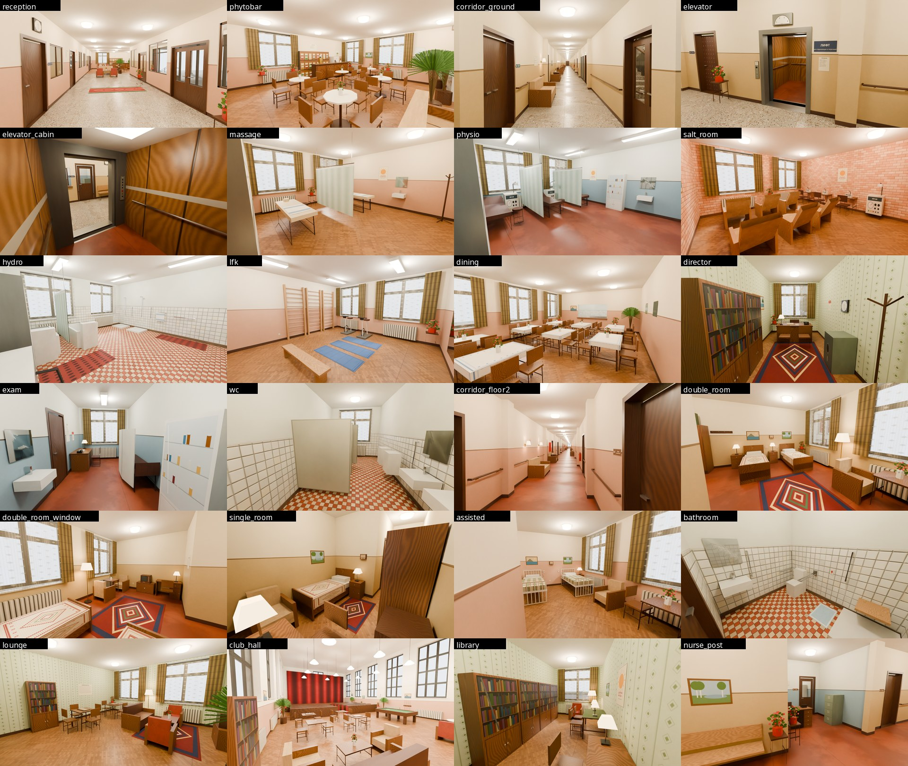
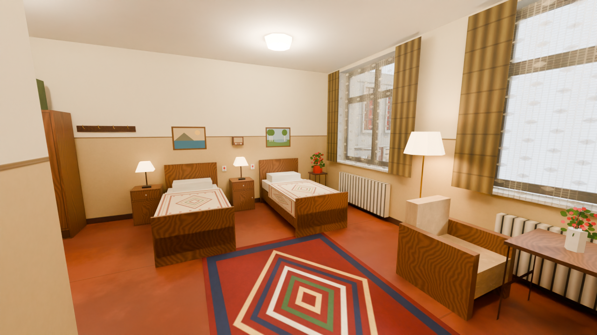
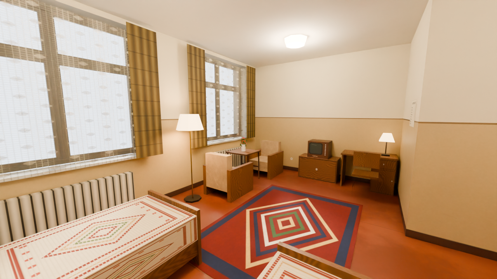
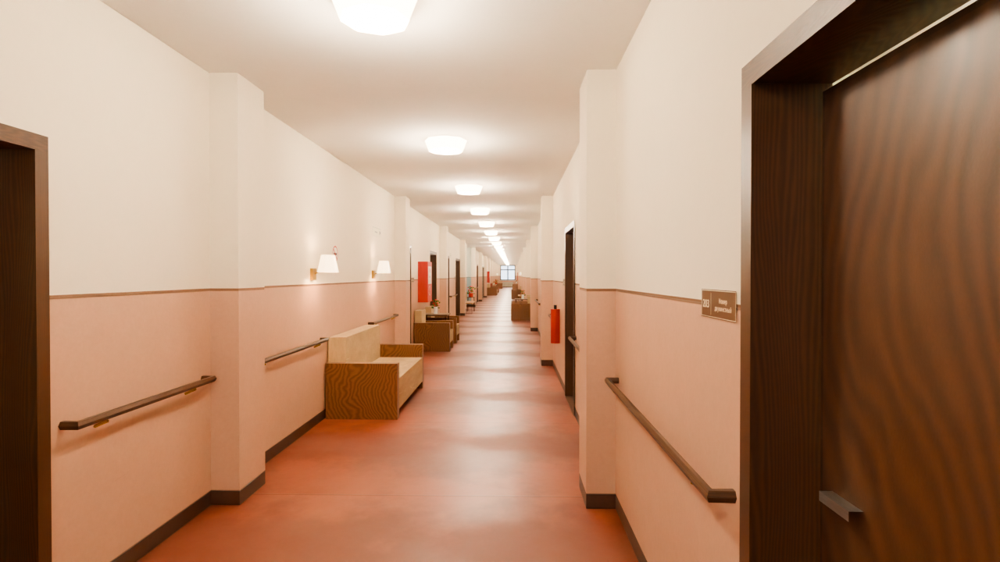
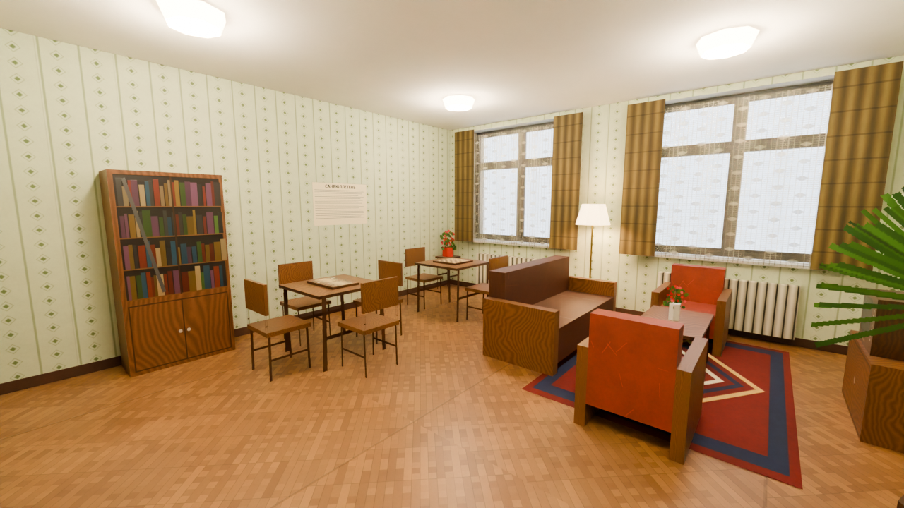
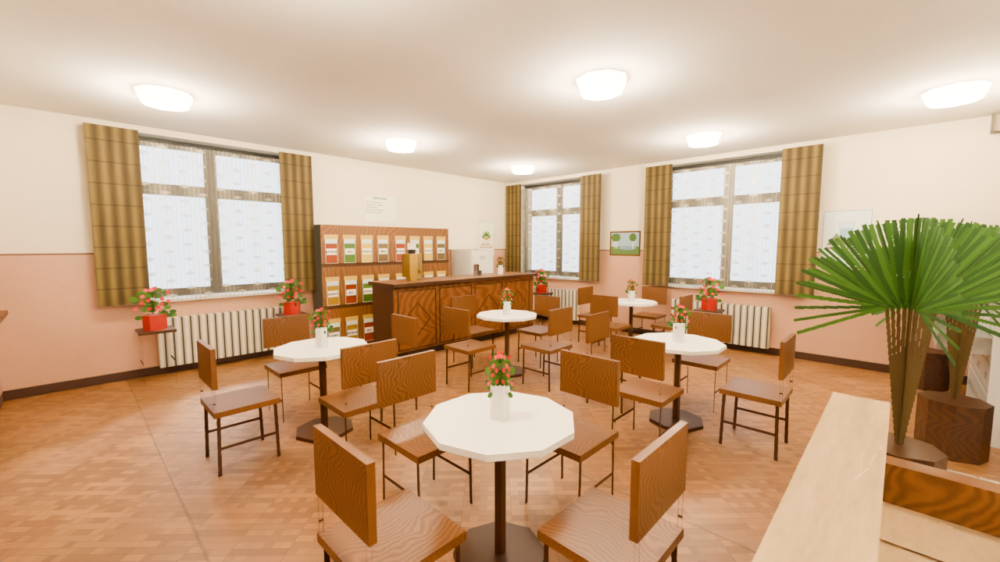
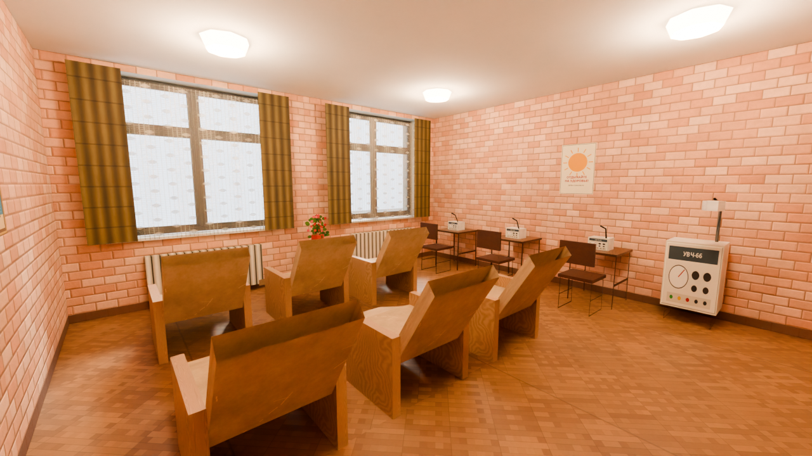
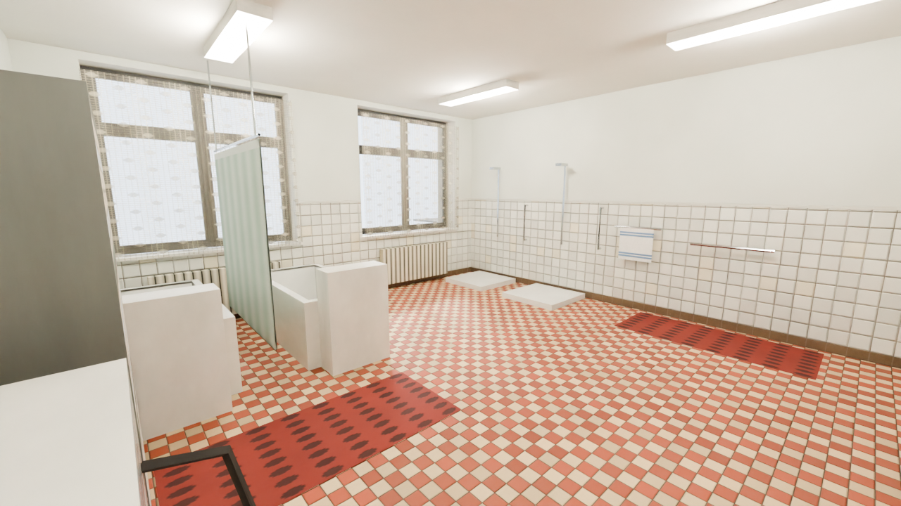

# Советское учебное здание 1970-х — low-poly 3D-модель

42 040 треугольников, реальный масштаб в метрах, 10 PBR-материалов с собственными текстурами. Модель включает рабочий пандус с поворотной площадкой.

## Посмотреть в 3D прямо в браузере

- [Открыть в Babylon.js Sandbox](https://sandbox.babylonjs.com/?assetUrl=https://raw.githubusercontent.com/samandarazamov73-bit/for-kiro/soviet-school-model/soviet_building/export/SovietSchool.glb&autoRotate=true)
- [Открыть в three.js glTF Viewer](https://gltf-viewer.donmccurdy.com/#model=https://raw.githubusercontent.com/samandarazamov73-bit/for-kiro/soviet-school-model/soviet_building/export/SovietSchool.glb)

Файл весит около 40 МБ, поэтому загрузка занимает некоторое время.

## Скачать

- [Всё одним ZIP-архивом](https://github.com/samandarazamov73-bit/for-kiro/archive/refs/heads/soviet-school-model.zip): модель во всех форматах, текстуры, рендеры, исходники
- [SovietSchool.glb](https://github.com/samandarazamov73-bit/for-kiro/raw/soviet-school-model/soviet_building/export/SovietSchool.glb): один файл, текстуры внутри (рекомендуется)
- FBX, OBJ, glTF — папка [`soviet_building/export`](soviet_building/export)
- PBR-текстуры (BaseColor, Normal, ORM, Roughness, AO, Metallic) — папка [`soviet_building/textures`](soviet_building/textures)

## Рендеры

| Спереди | Спереди слева, 3/4 |
|---|---|
|  |  |
| **Спереди справа, 3/4** | **Сзади** |
|  |  |
| **Сверху** | **Кровля** |
|  |  |
| **Пандус** | **Пандус, от низа маршей** |
|  |  |
| **Вход и лестница** | **Фасад и окна** |
|  |  |

Техническое описание (размеры, иерархия, материалы, параметры пандуса, исправления относительно референса, импорт в движки) — в [`soviet_building/README.md`](soviet_building/README.md).

## Интерьер санатория для пожилых отдыхающих

Внутри этого же здания построен полный интерьер уютного, чистого и полностью работающего советского санатория. Экстерьер не изменён. Сцена собрана в Blender 4.5 LTS.

- **Номера:** 51 номер на 94 места, у каждого свой санузел. 41 двухместный номер по 29–31 м², 8 одноместных, 2 номера для маломобильных (две функциональные кровати и проезд для коляски 1,1 м). В номерах застеленные кровати, тумбочки с лампами, кнопка вызова медсестры у изголовья каждой кровати, радиоточка на высоте 1,3 м, телевизор, ковёр, кресла у окна, торшер, письменный стол, шкаф, цветы.
- **1-й этаж:** вестибюль с зоной ожидания, регистратура, фитобар и бювет минеральных вод, водолечебница (ванны, души, душ Шарко), физиотерапия, массаж, соляная комната и ингаляторий, зал ЛФК, медотделение (у врачей рабочие столы, в смотровых кушетки и ширмы), столовая (у каждого стола полный комплект стульев), пищеблок, технические помещения. Администрация — 2 кабинета.
- **2–4 этажи:** номера, холл отдыха на каждом этаже (телевизор, шахматы, шашки, домино, нарды, книжные шкафы), пост медсестры, процедурная, доступный санузел. Клубный зал со сценой, бильярдом, игровыми столами и мягкими креслами. Библиотека на 4-м этаже.
- **Для пожилых:** поручни вдоль обеих стен всех коридоров, диваны, кресла и скамейки в коридорах, поручни в кабинках туалетов и у раковин, кнопки вызова, пассажирский лифт **без ключа** на 1000 кг (12 человек), на 1-м этаже двери лифта открыты.
- Все 526 светильников работают, свет тёплый, тёмных углов нет. Грязи, пятен, мусора, трещин, сломанных и мигающих ламп нет.
- Мебель расставлена с проверками: предметы не пересекаются, настенные плакаты, картины и таблички не накладываются друг на друга, лампы и телефоны стоят только на существующих столах, батареи стоят на полу под окнами.
- 212 помещений (161 комната и 51 санузел номеров), 237 дверей и проёмов, около 3200 предметов мебели. Интерьер — 113 764 треугольника, вместе с экстерьером 155 804 (лимит 200 000).

| Двухместный номер | Номер, вид от окна |
|---|---|
|  |  |
| **Коридор с поручнями и диванами** | **Холл отдыха** |
|  |  |
| **Фитобар и бювет** | **Клубный зал** |
|  |  |
| **Соляная комната** | **Водолечебница** |
|  |  |
| **Пассажирский лифт** | **Столовая** |
|  |  |

Планы этажей: [1](soviet_building/plans/plan_floor1.png), [2](soviet_building/plans/plan_floor2.png), [3](soviet_building/plans/plan_floor3.png), [4](soviet_building/plans/plan_floor4.png). Ведомость помещений: [`rooms.csv`](soviet_building/plans/rooms.csv). Все 24 рендера лежат в [`soviet_building/renders/interior`](soviet_building/renders/interior).

Файлы:
- [`SovietSanatorium.blend`](soviet_building/export/blend/SovietSanatorium.blend): сцена Blender, текстуры берутся из `soviet_building/textures`
- [`SovietSanatorium.glb`](soviet_building/export/SovietSanatorium.glb): здание целиком с интерьером, текстуры внутри файла
- [`SovietSanatorium_Interior.glb`](soviet_building/export/SovietSanatorium_Interior.glb): только интерьер
- [`SovietSanatorium.fbx`](soviet_building/export/fbx/SovietSanatorium.fbx)

Подробное описание (планировка, оснащение номеров, лифт, правила расстановки мебели, освещение, материалы, свойства объектов для движков, пересборка) — в [`soviet_building/INTERIOR.md`](soviet_building/INTERIOR.md).
