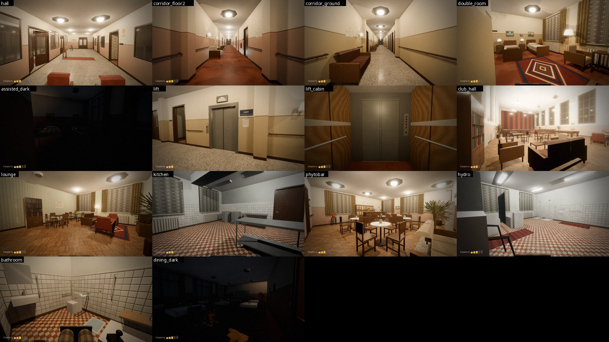

# Санаторий — игра на Godot 4.7

Вы в электроколяске, вид от первого лица. Ночь, полузаброшенный советский санаторий. Атмосфера страшноватая, но без перебора. Можно заехать в любую комнату: двери открываются, свет включается выключателем у двери, на другие этажи можно подняться на лифте. По лестнице на коляске не проехать, как и в жизни.



## Скачать готовую игру (без Godot)

Готовые сборки лежат в [релизе sanatorium-v1.0](https://github.com/samandarazamov73-bit/for-kiro/releases/tag/sanatorium-v1.0):

- **Windows:** `Sanatorium-Windows.zip` — распакуйте и запустите `Sanatorium.exe`.
- **Linux:** `Sanatorium-Linux.zip` — распакуйте и запустите `./Sanatorium.x86_64`.
- **Mac (Apple M1 и новее, Intel тоже):** `Sanatorium-macOS.zip` — распакуйте, первый раз откройте через правый клик → «Открыть». Рендер через Metal.

Если Windows покажет «Windows защитила ваш компьютер», нажмите «Подробнее» → «Выполнить в любом случае»: у игры нет цифровой подписи. Если macOS пишет, что приложение «повреждено», выполните в Терминале `xattr -cr /Applications/Sanatorium.app` (у игры нет платной подписи Apple).

**Качество графики** переключается клавишей G: «Низкое», «Среднее», «Высокое» (запоминается). На Mac по умолчанию «Среднее»: 3D рисуется не больше чем примерно в 1700×960 и растягивается на Retina-экран через AMD FSR 1, тени отбрасывают 5 ближайших ламп вместо 8, тень от луны рисуется в 2 зонах вместо 4 (чёткая примерно до 8 м, дальше мягче), SSIL выключен. «Высокое» совпадает с прежними настройками игры. Подробности — в `scripts/quality.gd`.

**Ограничение кадров** — клавиша L: не больше 30 кадров в секунду (запоминается). На «Среднем» видеочип MacBook не дотягивает до 60 кадров и работает на пределе, поэтому холоднее Mac становится только с ограничением. На MacBook Air, у которого нет вентилятора, оно включено сразу. В меню паузы игра рисует не больше 30 кадров, в фоне — 10.

Сборки делает GitHub Actions (`.github/workflows/build-game.yml`) при каждом изменении игры в ветке `sanatorium-game-release`. Настройки экспорта — в `export_presets.cfg`.

## Как запустить из исходников

1. Скачайте Godot **4.7** или новее (стандартная версия, не .NET): https://godotengine.org/download
2. Откройте Godot, нажмите **Import** и выберите файл `soviet_building/game/project.godot`.
3. При первом открытии Godot около минуты импортирует здание и текстуры.
4. Нажмите **F5** (Run Project).

Нужна видеокарта с поддержкой Vulkan (на Mac — Metal): рендерер Forward+ используется ради теней, объёмного тумана и большого числа ламп.

## Управление

| Действие | Клавиатура и мышь | Геймпад |
|---|---|---|
| Вперёд / назад | W / S (или стрелки) | левый стик |
| Поворот | A / D | левый стик |
| Смотреть по сторонам | мышь | правый стик |
| Открыть дверь, нажать выключатель или кнопку лифта | E или левая кнопка мыши | A |
| Скорость коляски 1–5 | колесо мыши, Q / R, − / + | LB / RB |
| Гудок | H | Y |
| Пауза | Esc | Start |
| Полный экран | F11 (Mac: Ctrl+Cmd+F) | |
| Качество графики | G | |
| Не больше 30 кадров/с | L | |

## Что есть в игре

**Электроколяска.** Физика близка к настоящей коляске с джойстиком:
- 5 режимов скорости, от 2,2 до 6,3 км/ч, назад 45 % от скорости вперёд;
- плавный разгон и более резкое торможение, когда джойстик отпущен;
- щелчок электромагнитных тормозов при старте и остановке; стоящая коляска не катится;
- разворот на месте, на скорости поворачивает медленнее;
- при смене направления передние колёсики разворачиваются и коляску чуть уводит в сторону;
- на уклоне коляска немного ускоряется или замедляется;
- о стену коляска не скользит, а останавливается с ударом и тряской камеры.

Видны подлокотники, джойстик (он наклоняется вместе с вводом), колени под пледом, подножка и колёса. Звук мотора и колёс зависит от скорости.

**Двери.** Все 218 дверей открываются по E и поворачиваются на петлях. Если дверь упирается в коляску, она останавливается. Около 14 % дверей при старте приоткрыты. Технические помещения (электрощитовая, машинное отделение лифта, склады и т. п.) и выходы наружу заперты.

**Свет.** 181 выключатель, в каждой комнате у двери. Из 526 ламп 75 перегорели и не горят, 29 мигают с треском. Коридоры, лестницы и вестибюль освещены, комнаты и кабинеты при старте тёмные. В нескольких номерах кто-то оставил свет. Настольные лампы, торшеры и бра включаются вместе со светом комнаты. Лампы дневного света гудят.

**Лифт.** На каждом этаже есть кнопка вызова, в кабине кнопки 1–4 и «Открыть двери». Двери закрываются перед поездкой и открываются по прибытии. Через несколько секунд они закрываются сами, а если коляска стоит в проёме, открываются снова. Кабина едет плавно, коляска едет вместе с ней.

**Крысы и тараканы.** Их немного: 12 крыс (2–3 на этаж) и 39 тараканов на кухне, в туалетах и душевых. Крысы бродят, нюхают воздух, иногда пищат. От коляски, гудка, хлопка двери или включённого света они убегают и прячутся, а потом появляются в другом месте. Тараканы сидят, дёргаются и разбегаются, если подъехать близко или включить свет.

**Звук.** Фоновый гул здания. Время от времени где-то на этаже раздаётся дальний скрип, капает вода, стучат трубы, дует ветер, изредка хлопает дверь. Есть эхо (реверберация). Всего 33 звука, все сгенерированы скриптом `tools/blender/sfx_gen.py`.

**Картинка.** Ночь, луна светит в окна. Тени от ближайших ламп, лёгкий объёмный туман, SSAO, приглушённые цвета, виньетка и плёночный шум. При входе в комнату вверху показываются её номер и название.

## Файлы

| Путь | Что это |
|---|---|
| `project.godot`, `main.tscn` | Проект и главная сцена |
| `assets/sanatorium.glb` | Здание целиком (экстерьер и интерьер), без источников света |
| `assets/level.json` | Описание уровня: комнаты, двери (петли, сторона открывания, замки), лампы и их состояние, выключатели, лифт, коробки столкновений мебели, запреты лестниц, места для крыс и тараканов |
| `assets/sfx/*.wav` | Звуки |
| `assets/fonts/` | Шрифт Noto Sans (кириллица) и его лицензия OFL |
| `scripts/game.gd` | Загрузка здания, столкновения, окклюдеры, окружение, ввод |
| `scripts/wheelchair.gd` | Коляска: физика, камера, звук, взаимодействие |
| `scripts/door_group.gd`, `switch.gd`, `lights.gd`, `lift.gd`, `critters.gd`, `ambience.gd`, `hud.gd` | Двери, выключатели, свет, лифт, крысы и тараканы, звук, интерфейс |
| `tests/test_runner.gd` | Автоматические проверки и скриншоты |

Здание, `level.json` и звуки создаются из исходников в `soviet_building/tools/blender`:

```
python texgen_interior.py      # текстуры
python build_sanatorium.py     # модель, экспорт GLB/FBX и файлы игры в game/assets
python sfx_gen.py              # звуки
```

## Проверка

```
godot --headless --path soviet_building/game -- --test
```

27 автоматических проверок, все проходят:
- коляска стоит на полу, едет, разворачивается, развивает 6,3 км/ч и останавливается о стену;
- двери открываются и закрываются, запертые не открываются;
- лифт по вызову открывает двери, коляска заезжает в кабину и едет на 3-й этаж вместе с ней, выезжает в коридор, лифт вызывается на другой этаж;
- лестница коляске недоступна;
- выключатель включает и выключает свет;
- крыса убегает.

Скриншоты в `renders/game/` сделаны прямо из игры (`-- --shots --out=<папка>`). Они рендерились программно, без видеокарты, поэтому на настоящей видеокарте картинка будет такой же или лучше.

## Ограничения

- Сюжета, заданий и сохранений нет: это свободное исследование здания.
- Коляска не толкает мебель: вся мебель неподвижна.
- Частоту кадров на реальной видеокарте я не измерял, потому что в моей среде видеокарты нет. В здании около 4800 объектов. Для скорости работают окклюзия по стенам, отсечение мелких предметов по расстоянию и тени только у 8 ближайших ламп. Если будет медленно, в `scripts/lights.gd` можно уменьшить `SHADOWS`, а в `scripts/game.gd` отключить `volumetric_fog_enabled` и `ssil_enabled`.
